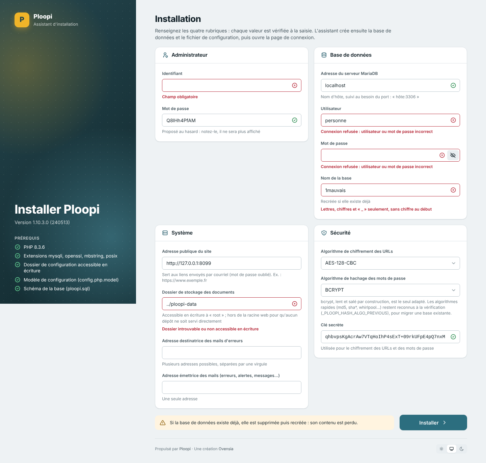

# Déployer Ploopi

Deux voies :

- **Docker** — le plus simple, pour essayer Ploopi ou pour une petite installation :
  guide pas à pas dans [`docker/LISEZMOI.md`](../docker/LISEZMOI.md) ;
- **installation manuelle** sur un serveur Debian / Ubuntu (Apache + PHP + MariaDB) :
  ce document.

Pour développer, voir plutôt [`developpement.md`](developpement.md).

---

## 1. Prérequis

| Composant | Version |
|---|---|
| PHP | **8.1 à 8.5** (éprouvé en CI sur chacune) |
| Extensions PHP | `mysqli`, `gd`, `zip`, `curl`, `xml`, `mbstring`, `openssl`, `memcached` ; `intl` et `exif` recommandées |
| Base de données | MariaDB 10.11 (version de la CI) ou MySQL |
| Serveur web | Apache 2.4 avec `mod_rewrite`, `mod_headers`, `mod_expires` et `AllowOverride All` |
| Outils | Composer, git |

Outils système facultatifs, utilisés par la GED (module `doc`) pour indexer et
prévisualiser les documents : `catdoc`, `poppler-utils` (`pdftotext`), `unrtf`,
`jhead`, `unoconv` / LibreOffice (conversions), `ffmpeg` (vignettes vidéo),
ImageMagick. En leur absence, les documents sont stockés normalement mais leur contenu
n'est pas indexé.

L'extension `memcached` n'est utile que si les sessions sont confiées à memcached
(`_PLOOPI_SESSION_HANDLER`). Sans elle, ajouter `--ignore-platform-req=ext-memcached`
aux commandes `composer install` ci-dessous.

## 2. Paquets (Debian / Ubuntu)

```sh
sudo apt update
sudo apt install --yes apache2 libapache2-mod-php mariadb-server composer git unzip \
    php php-cli php-mysql php-gd php-zip php-curl php-xml php-mbstring php-intl \
    php-memcached memcached \
    catdoc poppler-utils unrtf jhead unoconv ffmpeg imagemagick
sudo a2enmod rewrite headers expires
sudo systemctl restart apache2
```

## 3. Base de données

```sh
sudo mariadb -e "CREATE DATABASE ploopi CHARACTER SET utf8mb4;
                 CREATE USER 'ploopi'@'localhost' IDENTIFIED BY 'un-vrai-mot-de-passe';
                 GRANT ALL PRIVILEGES ON ploopi.* TO 'ploopi'@'localhost';"
```

## 4. Code et dépendances

```sh
sudo git clone https://github.com/faf2019/ploopi.git /var/www/ploopi
cd /var/www/ploopi
sudo composer install --no-dev --no-interaction
sudo cp .htaccess_modele .htaccess
```

`composer.lock` est versionné : l'installation est reproductible, avec les versions
éprouvées par la CI.

### Dossier des documents, hors de la racine web

L'assistant propose par défaut `../ploopi-data` : aucun document déposé ne peut y être
servi directement, même si la protection du `.htaccess` venait à sauter. Le créer
avant l'installation :

```sh
sudo mkdir /var/www/ploopi-data
sudo chown www-data:www-data /var/www/ploopi-data
```

### Droits des fichiers

Le code reste en lecture seule pour Apache ; seuls `config/` (écrit par l'assistant),
`modules/` (installation des modules depuis le backoffice) et le dossier des documents
sont inscriptibles :

```sh
sudo tools/postinstall.sh www-data:www-data /var/www/ploopi-data
```

À relancer après chaque mise à jour du code.

## 5. Apache

`/etc/apache2/sites-available/ploopi.conf` :

```apacheconf
<VirtualHost *:80>
    ServerName ploopi.exemple.fr
    DocumentRoot /var/www/ploopi

    <Directory /var/www/ploopi>
        AllowOverride All
        Require all granted
    </Directory>
</VirtualHost>
```

```sh
sudo a2dissite 000-default
sudo a2ensite ploopi
sudo systemctl reload apache2
```

Le `.htaccess` (copié de `.htaccess_modele`) porte les règles de réécriture du
frontoffice, interdit l'accès direct à `config/`, `bin/`, `data/`, `install/`… et sert
les versions `.gz` des JS/CSS.

En production, **servir le site en HTTPS** (Certbot :
`sudo apt install certbot python3-certbot-apache && sudo certbot --apache`), et
masquer la version d'Apache dans `/etc/apache2/conf-enabled/security.conf` :

```apacheconf
ServerTokens Prod
ServerSignature Off
```

## 6. Assistant d'installation

Ouvrir le site dans un navigateur : sans `config/config.php`, l'assistant s'affiche. Il
demande le serveur et le compte de la base, le dossier des documents, l'adresse
publique du site et le compte administrateur, puis crée les tables et écrit
`config/config.php` (clés de chiffrement générées à cette occasion).

L'assistant a l'habillage de `ploopi4` (feuilles et icônes du gabarit, thème clair ou
sombre). Il affiche ses prérequis (version de PHP, extensions, dossier de configuration
accessible en écriture, modèle de configuration et schéma présents) et vérifie chaque
champ à la saisie : serveur joignable, identifiants acceptés, nom de base valide,
dossier des documents accessible en écriture. Une tentative refusée n'écrit rien et
réaffiche le formulaire, champs en cause signalés. **Si la base existe déjà, elle est
supprimée puis recréée.**



Le backoffice est ensuite sur `/admin.php`.

Les modules (GED, site web, wiki, formulaires…) s'installent depuis
*Administration système → Installation des modules*, puis se rattachent aux espaces de
travail.

Pour découvrir Ploopi, tant qu'aucun module n'est installé, *Système → Modules* propose
**Générer le site de démonstration** : un clic installe le module Site web (webedit) et
publie un petit site fictif dans le premier espace de travail, frontoffice ouvert, avec
le gabarit `corporate` (`ploopi\system\demo`). Il installe aussi, quand leur paquet est
livré, un annuaire (directory : organigramme et contacts), un agenda (planning) et une
réservation de salles (booking) garnis de rendez-vous de la semaine courante, des
actualités (news2) et des rapports (dbreport : requêtes sur l'annuaire, dont un
graphique). Le bouton disparaît dès qu'un module est installé : il ne peut rien écraser.

### Adresse publique

Les liens envoyés par courriel (mot de passe oublié…) sont bâtis sur
`_PLOOPI_PUBLIC_URL`, que l'assistant renseigne, et jamais sur l'entête `Host` de la
requête, que n'importe qui choisit. Pour une installation antérieure à cette constante,
ajouter à `config/config.php` :

```php
define ('_PLOOPI_PUBLIC_URL', 'https://ploopi.exemple.fr');   // schéma, hôte, chemin
define ('_PLOOPI_LOSTPASSWORD_DELAY', 3600);                 // validité du lien, en secondes
```

Sans elle, seul un hôte déclaré en clair dans les domaines d'un espace reçoit un lien
(le joker `*` ne compte pas) ; ailleurs, la demande est refusée et journalisée.

## 7. Tâches planifiées et ligne de commande

Le point d'entrée `cron` lance le traitement périodique de chaque module qui en déclare
un (entité `cron` de son contrôleur, ou `cron.php`). Aucun module livré n'en a
aujourd'hui : la ligne de crontab n'est utile qu'avec un module qui en a besoin.

```sh
# crontab de www-data : sudo crontab -u www-data -e
* * * * * php /var/www/ploopi/cron > /dev/null 2>&1
```

Opérations de maintenance ponctuelles, avec `cli` : par exemple la réindexation de la
GED, `sudo -u www-data php cli module=doc op=reindex`.

`cli` et `cron` ne sont pas joignables par le web (le `.htaccess` les interdit).

## 8. Réglages notables de `config/config.php`

La variable d'environnement `PLOOPI_CONFIG` désigne, si elle est renseignée, un autre
fichier de configuration (chemin complet), lu par Ploopi et écrit par l'assistant : par
exemple pour le garder hors de la racine web. Ploopi la lit par `getenv()` : elle doit être
visible de PHP pour le site comme pour les tâches planifiées (`cli`, `cron`). L'image
Docker s'en sert pour garder sa configuration dans un volume.

Le fichier, généré par l'assistant depuis `config/config.php.model`, est commenté. Les
constantes à revoir le plus souvent :

| Constante | Rôle |
|---|---|
| `_PLOOPI_PATHDATA` | dossier des documents (hors racine web) |
| `_PLOOPI_MAXFILESIZE` | taille maximale d'un dépôt (à accorder avec `upload_max_filesize` et `post_max_size` de PHP) |
| `_PLOOPI_SESSIONTIME`, `_PLOOPI_SESSION_HANDLER` | durée de session ; `php`, `db`, `file` ou `memcached` |
| `_PLOOPI_DISPLAY_ERRORS` | **`false` en production** |
| `_PLOOPI_LOG_ERRORS_FILE` | journal des erreurs PHP |
| `_PLOOPI_ADMINMAIL`, `_PLOOPI_SYSMAIL` | destinataire des alertes, expéditeur des courriels |
| `_PLOOPI_FRONTOFFICE`, `_PLOOPI_FRONTOFFICE_REWRITERULE` | site public et URL réécrites |
| `_PLOOPI_USE_COMPLEXE_PASSWORD`, `_PLOOPI_MAX_CONNECTION_ATTEMPS`, `_PLOOPI_JAILING_TIME` | politique de mots de passe et blocage après échecs |
| `_PLOOPI_INTERNETPROXY_*` | mandataire HTTP sortant |
| `_PLOOPI_CSP` | Content-Security-Policy : `strict` (défaut), `base` ou `report` (ci-dessous) |

Un même code peut servir plusieurs configurations : le fichier est structuré par
`switch ($http_host)`.

### Content-Security-Policy

Ploopi pose lui-même ses entêtes CSP (`ploopi\csp`) ; ne pas en ajouter une autre dans
la configuration d'Apache ou d'un mandataire inverse, qui se cumulerait avec elles (un
navigateur applique toutes les politiques reçues).

| Politique | Où | Effet |
|---|---|---|
| de base, appliquée | partout | ni plugin (`object-src`), ni `<base>` détourné, ni mise en cadre par un autre site ; en backoffice, ni script d'une autre origine, ni formulaire posté ailleurs |
| stricte, appliquée | page de connexion et écrans de `system` sous `ploopi4` | seuls les scripts du site et ceux du socle portant le nonce de la session s'exécutent : ni gestionnaire `onclick`, ni URL `javascript:`, ni `eval` |
| cible, Report-Only | partout | la politique stricte, mesurée : chaque écart est journalisé (`CSP Report-Only : …`) |

Une page déclarée prête qui contient malgré tout du script en ligne (composant historique
inséré) garde la politique de base : rien ne casse, l'écart est journalisé
(`CSP stricte non appliquée …`). Un blocage effectif est journalisé `CSP bloquante : …`.
Le frontoffice n'a que la politique de base sans `script-src` ni `form-action` : les
gabarits et les articles des sites peuvent appeler des services tiers.

En cas de doute après une mise à jour, `define('_PLOOPI_CSP', 'base');` retire la
politique stricte, `'report'` revient à la seule mesure.

## 9. Mettre à jour

```sh
cd /var/www/ploopi
sudo git pull
sudo composer install --no-dev --no-interaction
sudo tools/postinstall.sh www-data:www-data /var/www/ploopi-data
```

Puis, dans le backoffice, avec un compte administrateur système :

1. **le socle** : si la version de la base est antérieure à celle du code, la page
   *Administration système* propose la mise à jour, qui applique les scripts
   `install/system/update_ploopi_*.sql` manquants ;
2. **les modules** : *Administration système → Installation des modules → Mettre à
   jour* pour chaque module signalé ; la mise à jour copie les fichiers, applique les
   scripts SQL du module, retire ses fichiers obsolètes et recharge la métabase.

Faire une sauvegarde **avant** toute mise à jour.

**Réindexer après la mise à jour d'octobre 2026** (remplacement de soundex-fr-bundle
par `ploopi\phonetique`, découpage des mots en UTF-8, racines calculées sur le mot
accentué) : les codes phonétiques, les mots contenant ç, ë, û, ã ou õ (auparavant
coupés en deux : « garçon » indexé « gar » et « on ») et les racines des mots accentués
(« abandonnée » indexé « abandonne », désormais « abandon ») ont changé. La recherche
ne retrouve les anciens contenus qu'une fois ceux-ci réindexés — menu *Réindexation* du
site web, menu *Réindexer* du wiki (administrateur système), et pour la GED
`sudo -u www-data php cli module=doc op=reindex`.

Les étiquettes d'articles déjà enregistrées gardent leur forme : une étiquette saisie
« garçon » a été enregistrée « gar on » et se corrige en la ressaisissant.

### Migrer le dossier des documents hors de la racine web

Une installation dont `_PLOOPI_PATHDATA` est sous la racine web (valeur historique
`./data`) se déplace sans perte :

```sh
# service arrêté
sudo mv /var/www/ploopi/data /var/www/ploopi-data
# puis, dans config/config.php :
#   define('_PLOOPI_PATHDATA', realpath('/var/www/ploopi-data'));
# et ajuster _PLOOPI_PATHSHARED / _PLOOPI_PATHCACHE si besoin
```

## 10. Sauvegarder

Trois éléments, à sauvegarder ensemble :

```sh
mariadb-dump --single-transaction ploopi > ploopi-$(date +%F).sql   # la base
tar czf ploopi-data-$(date +%F).tgz -C /var/www ploopi-data          # les documents
cp /var/www/ploopi/config/config.php config-$(date +%F).php          # la configuration
```

`config/config.php` contient les clés de chiffrement (`_PLOOPI_CIPHER`,
`_PLOOPI_SECRETKEY`…) : sans lui, les URL chiffrées et certaines données ne se
relisent plus. Le conserver avec la sauvegarde, en lieu sûr.

## 11. Check-list de mise en production

- [ ] HTTPS actif, HTTP redirigé
- [ ] `.htaccess` en place (copie de `.htaccess_modele`)
- [ ] dossier des documents hors de la racine web, inscriptible par Apache seulement
- [ ] code en lecture seule pour Apache (`tools/postinstall.sh`)
- [ ] `_PLOOPI_DISPLAY_ERRORS` à `false`, journal des erreurs hors racine web
- [ ] `_PLOOPI_PUBLIC_URL` renseignée
- [ ] mot de passe administrateur fort ; mots de passe complexes activés si besoin
- [ ] sauvegardes planifiées et **restauration éprouvée**
- [ ] PHP de production (`php.ini-production`), `expose_php = Off`
