# Habillage du backoffice : le gabarit `ploopi4`

`ploopi4` est un **shell adaptatif** pour le backoffice : barre supérieure, menu
latéral (complet, réduit en rail, ou en tiroir sur téléphone), thèmes clair et sombre,
densité d'affichage. Il reprend le style de la maquette ARGOS
([`argos/maquette/utilisateurs.html`](https://github.com/faf2019/argos/blob/recette/maquette/utilisateurs.html)),
sous la palette de Ploopi, et refond **tous les écrans du module `system`** : espaces de
travail, niveau Système, Mon espace.

Ce sont les deux premiers jalons de l'étude [`etude-ploopi4.md`](etude-ploopi4.md). Le
code des modules n'est pas modifié : leurs écrans s'affichent dans le nouveau shell,
avec l'aspect de `ploopi3`.

Captures : [`screenshots/ploopi4/`](../screenshots/ploopi4/).

| | |
|---|---|
| 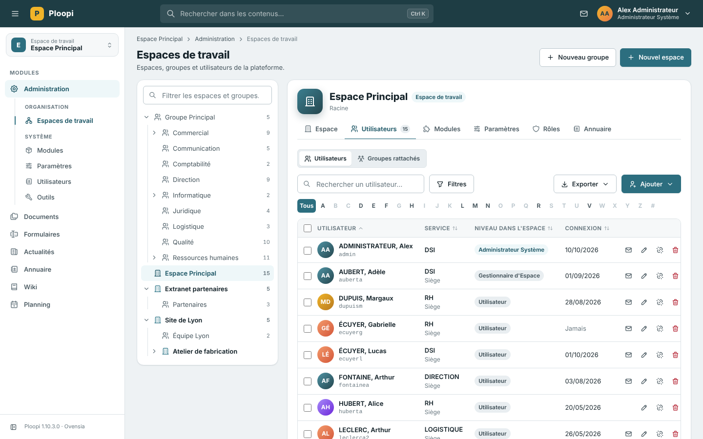 | 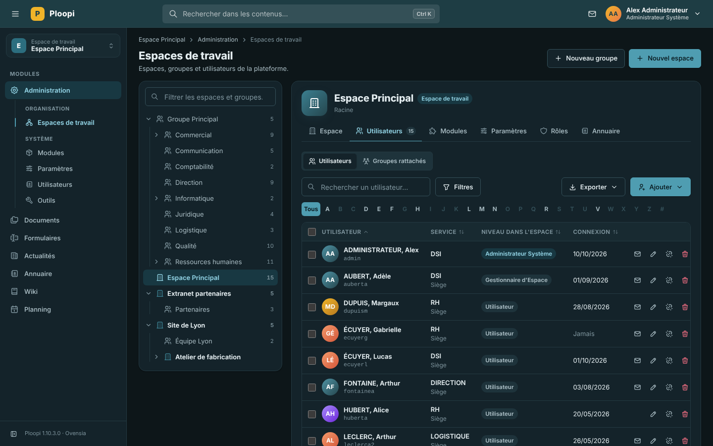 |
| 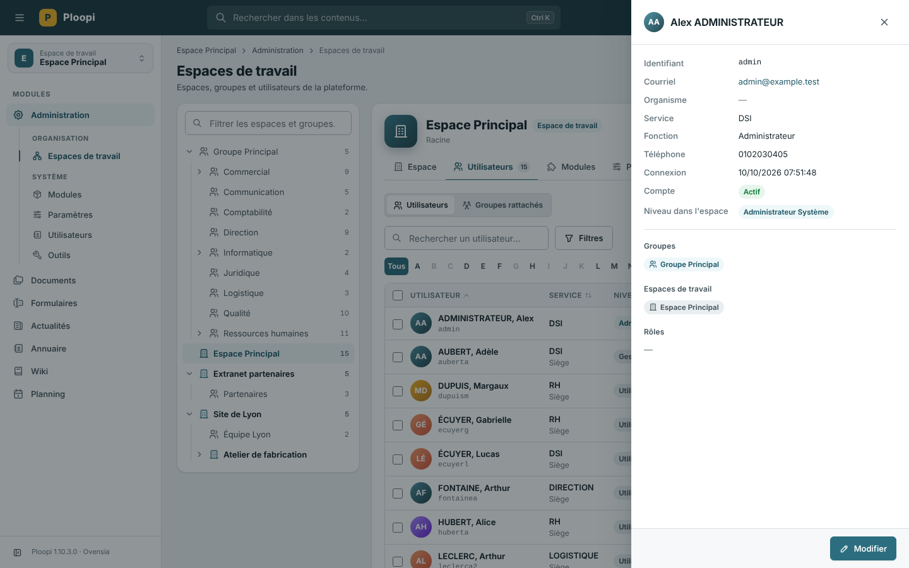 | 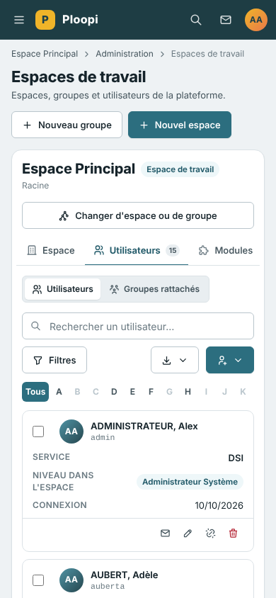 |
| 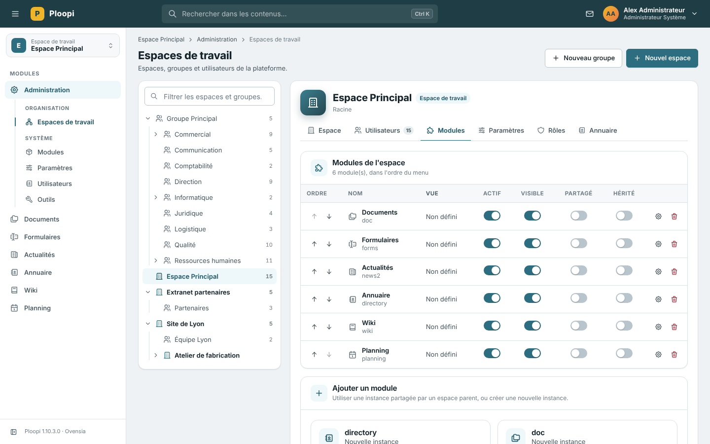 | 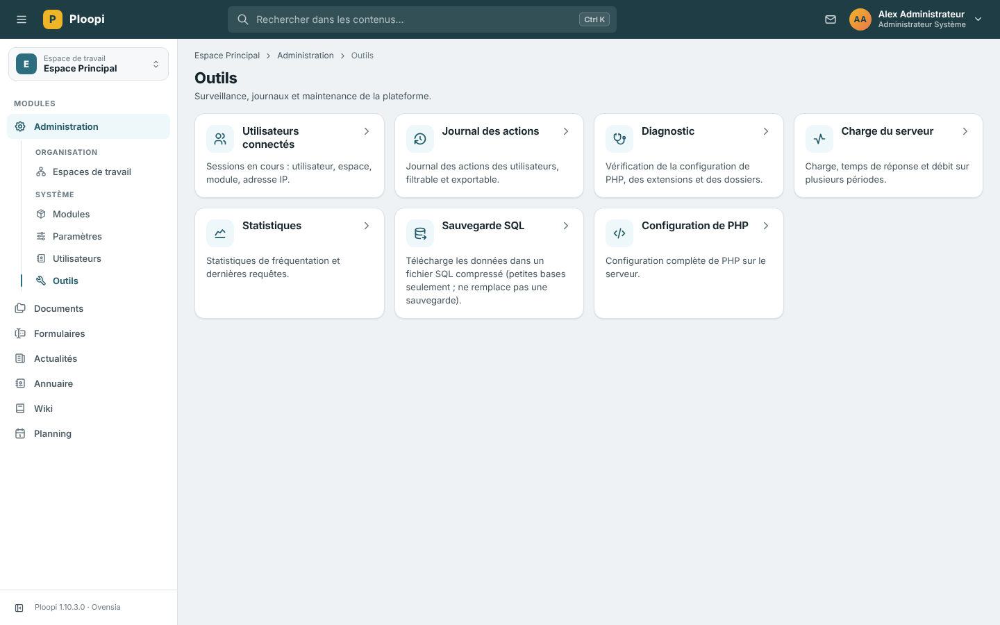 |
| 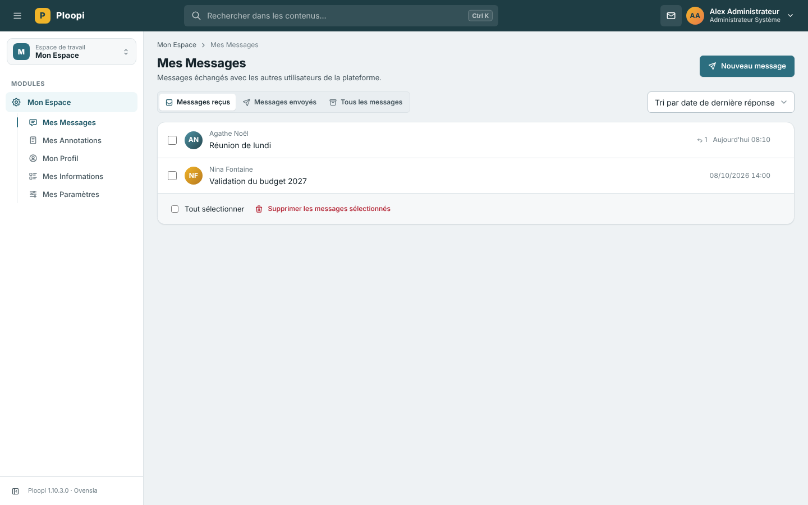 | 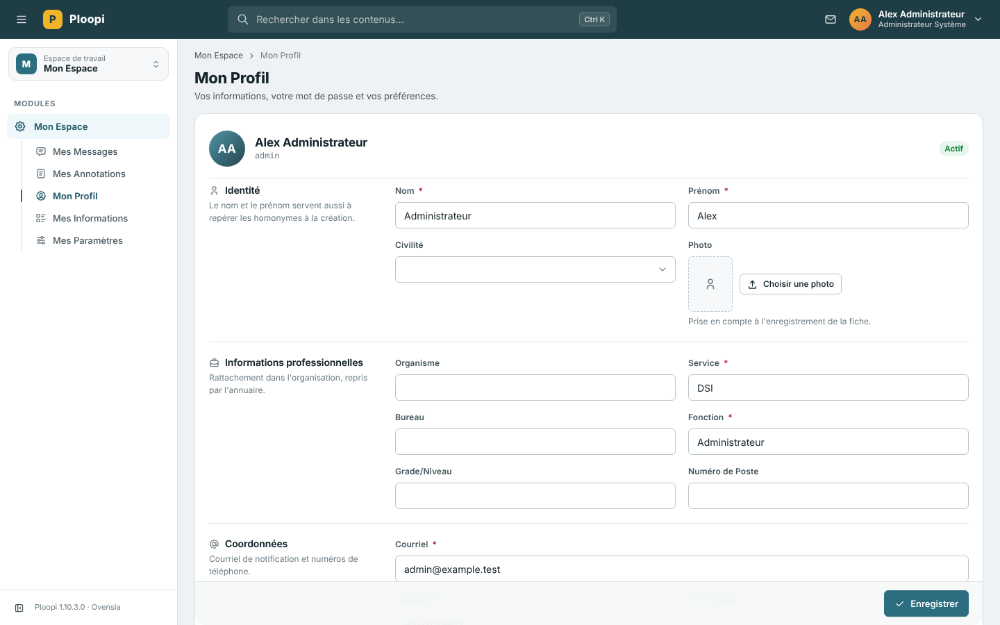 |
| 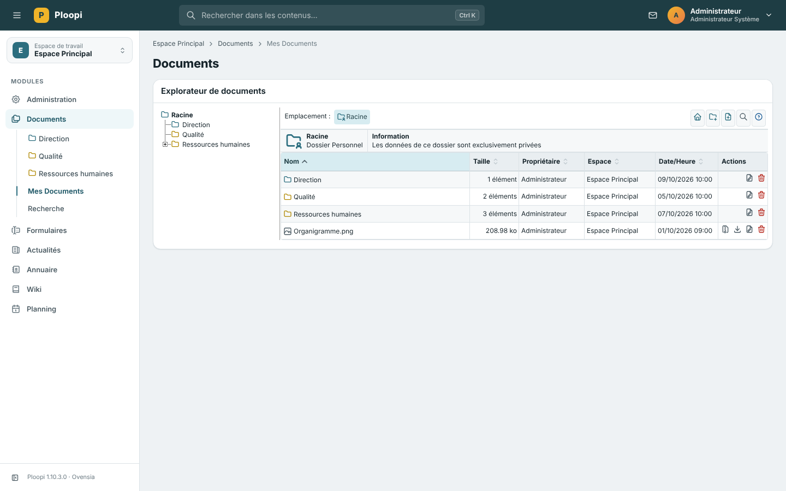 | 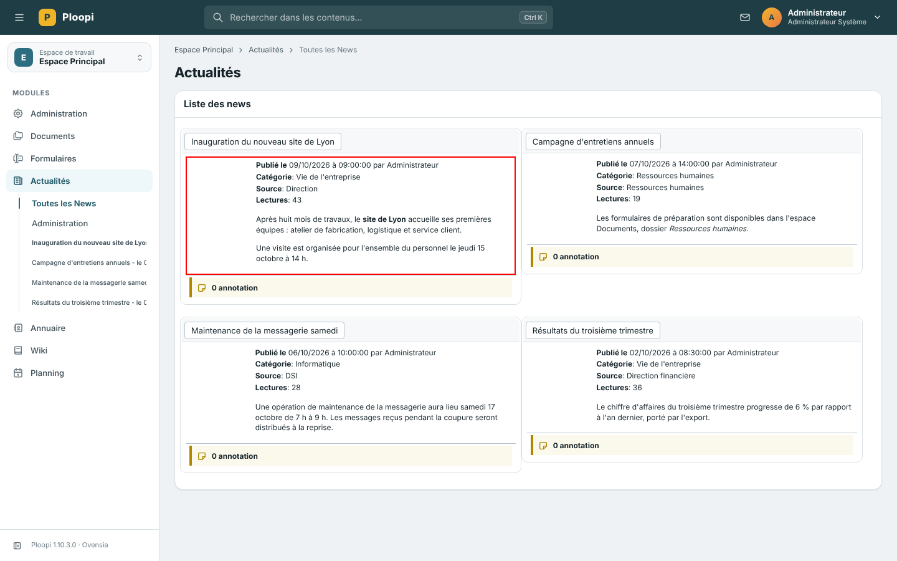 |
| 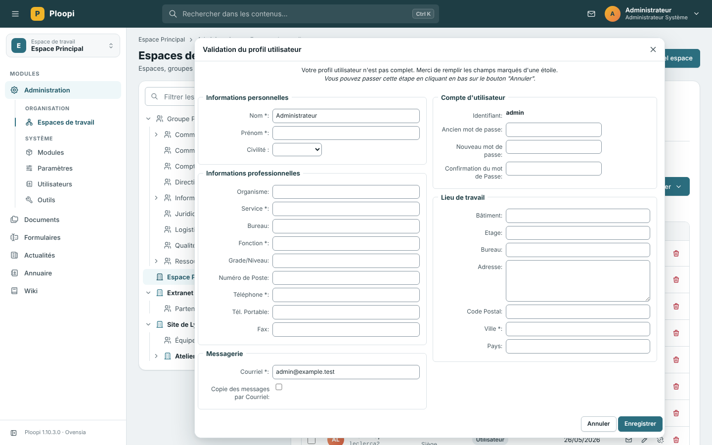 | 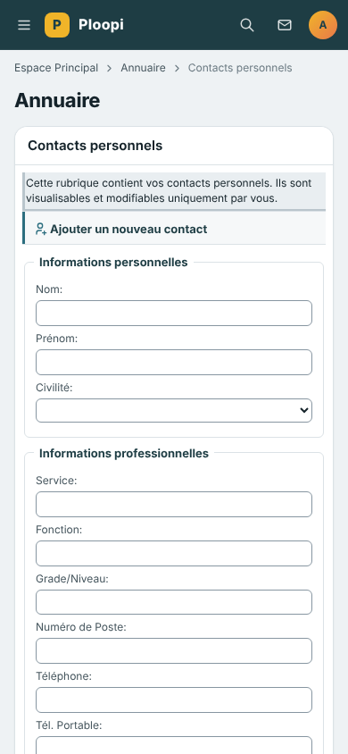 |

---

## 1. Activer, revenir en arrière

Comme `ploopi3` (`doc/habillage.md` § 4) : *Administration → Espaces de travail →*
l'espace *→ onglet Espace → Habillage : `ploopi4`*, ou `_PLOOPI_DEFAULT_TEMPLATE` dans
`config/config.php` pour les espaces sans habillage renseigné. Retour arrière : remettre
`ploopi3`. **Les installations neuves sont en `ploopi4`** depuis le 10 octobre 2026
(`install/system/ploopi.sql`, `config/config.php.model`) ; une installation existante
garde son habillage tant qu'on ne la bascule pas. Limites connues : § 8.

La version du socle passe à **1.10.3.0** : *Système → Mise à jour* ajoute les deux
paramètres d'affichage (§ 4). Sans cette mise à jour, `ploopi4` fonctionne, avec le
thème du système et la densité confortable.

### 1.1 Déclinaison `ploopi4.1` : autres couleurs

`ploopi4.1` est `ploopi4` avec une autre palette (« indigo et corail ») : mêmes écrans,
mêmes comportements, mêmes correctifs. Son dossier ne contient que `skin.ini`
(`extends = ploopi4`) et `css/palette.css`, qui redéfinit les jetons de couleur de
`base_0_jetons.css` (marque, accent, surfaces, texte, états, ombres ; thèmes clair, sombre
et automatique) et les rares couleurs écrites hors des jetons (visuel de connexion,
avatar). Il se choisit comme un autre habillage (*onglet Espace → Habillage*).

Mécanisme, réutilisable pour d'autres palettes : `ploopi\skin::resolve($nom)` renvoie,
pour un dossier sans `index.tpl` dont le `skin.ini` porte `extends`, le dossier du gabarit
étendu (servi comme `template_path` : gabarits, scripts, icônes, polices, feuilles) et la
feuille `css/palette.css` de la déclinaison, que `index.tpl` et `light.tpl` chargent après
`styles.pack.css` (bloc `template_palette`). Un seul niveau ; un nom hors de
`templates/backoffice` est refusé. La liste des habillages proposés
(`system::getavailabletemplates`) inclut les déclinaisons. Les contrastes de la palette
(WCAG AA : texte 4,5:1, contours de saisie 3:1, en clair et en sombre) sont vérifiés par
la suite 37.

## 2. Ce qui ne change pas : le contrat avec le socle et les modules

Celui de `ploopi3`, vérifié par la suite 37 :

- **`#pagecontent.hook`** reste le conteneur qui défile, où `ploopi.popup` accroche ses
  fenêtres ; **`#background`** enveloppe l'application ; `#ploopi_mod_mess`,
  `#tpl_ploopi_tickets_new` et les identifiants du formulaire de connexion sont présents ;
- **balisage du socle inchangé** : `create_pagetitle`, `open_simplebloc`, `create_tabs`,
  `create_toolbar`, `ploopi\form*` produisent le même HTML. Seul leur aspect change, par
  les feuilles de la zone historique. Seule exception, `display_array` (§ 4.1) : mêmes
  arguments, mais un tableau fluide à la place de la structure `ploopi_explorer_*`, que
  ni les modules ni le socle ne lisent ;
- **géométrie des modules** : texte à 12 px et modèle de boîte d'origine dans la zone
  historique ; les champs et boutons gardent les marges intérieures de `ploopi3` (les
  formulaires en `float` à 30 % / 65 % en dépendent) ;
- **images** : `img/` est la copie de celle de `ploopi3`, mêmes noms et tailles ;
  `skin.ini` porte les mêmes clés.

## 3. Organisation du gabarit

```
templates/backoffice/ploopi4/
├── index.tpl          shell connecté, page de connexion
├── light.tpl          rendu allégé (admin-light.php)
├── ticket.tpl         courriel de la messagerie (copie de ploopi3)
├── class_skin.php     skin::icon() : icône du sprite ; fenêtres (create_popup,
│                      open_popup) à en-tête de ploopi4
├── skin.ini           clés de ploopi3, version = 4, icon_<type de module>
├── js/shell.js        ploopi.shell : menus, menu latéral, thème, densité, tiroirs,
│                      raccourcis, page de connexion
├── img/icons.svg      sprite Tabler (tools/ploopi4_icones.php), plus img/ de ploopi3
├── fonts/             Inter (OFL), auto-hébergée ; Nunito réduite aux lettres du logotype
└── css/
    ├── base_0_jetons.css          palette claire et sombre, densité, variables --p3-*
    ├── base_1_socle.css           éléments de base, interface .p4-ui / zone historique
    ├── base_2_composants.css      boutons, champs, cartes, menus, tiroirs, tableaux…
    ├── base_3_shell.css           barre supérieure, menu latéral, zone principale
    ├── base_4_connexion.css       page de connexion
    ├── base_5_*.css               feuilles de ploopi3 (zone historique)
    ├── base_6_historique.css      champs, boutons, blocs, fenêtres de la zone historique
    ├── base_7_administration.css  écran des espaces de travail
    ├── base_8_ecrans.css          autres écrans refondus du module system
    ├── base_9_enligne.css         couleurs écrites en ligne par les modules, en jetons
    ├── base_9_modules.css         écrans des modules : fenêtres, petits écrans
    └── styles.pack.css(.gz)       agrégat (tools/compress.sh)
```

**Deux mondes dans la page.** L'interface de `ploopi4` porte la classe `p4-ui` et des
classes préfixées `p4-` (les modules emploient librement `.button`, `.tabs`, `.menu`…) :
boîtes en `border-box`, texte à la densité choisie. Le reste est la **zone historique** :
contenu des modules et fenêtres `ploopi.popup`, à 12 px. Les règles d'éléments de la
zone historique (`input`, `button`…) excluent `.p4-ui` par
`:where(:not(.p4-ui *), .p4-legacy :not(.p4-legacy .p4-ui *))`, sans changer leur
spécificité. Un composant historique posé dans une carte refondue (GED attachée à la
fiche d'un utilisateur, annotations) s'enveloppe dans `<div class="p4-legacy">`, qui le
rend à la zone historique, hors des composants de `ploopi4` qu'il contient lui-même.

**Thème sombre.** Les feuilles de `ploopi3` écrivent leurs couleurs dans des variables
`--p3-*`, redéfinies dans `base_0_jetons.css` à partir des jetons de `ploopi4` : elles
suivent donc le thème, contenu des modules compris. Les couleurs que ces feuilles
écrivaient en dur (bandeaux d'annotations, d'abonnements, de validation et de partage ;
calendriers du planning et des réservations) sont des teintes calculées sur les jetons
(`color-mix(in srgb, <teinte> 6%, var(--p3-surface))`) : à peu près les mêmes en clair,
foncées en sombre. Les couleurs que les modules écrivent **en ligne** (`style="color:#a60000"`,
ligne en cours en `#ffe0e0`…) sont reprises par `base_9_enligne.css`, dans les deux thèmes ;
la suite 37 vérifie que chaque couleur de texte en ligne des modules y figure. Les
lignes alternées que le socle et les modules lisent dans `skin.ini` (`bgline1`, `bgline2`,
`colprim`, `colsec`) y sont des jetons (`var(--surface)`). Un événement coloré du calendrier
(couleur d'une ressource, état d'une réservation) garde un texte sombre, ses teintes étant
claires. L'éditeur riche (TinyMCE, `js/editor.js`) suit le thème : interface et contenu
sombres sous le thème sombre. Reste clair, par nature : l'aperçu des pages du site (contenu
du frontoffice, avec son propre gabarit), y compris l'édition d'un article de `webedit`. `.p4-clair` force le thème clair sur un
sous-arbre.

| Planning | GED (abonnement, annotations) | Saisies de forms |
|---|---|---|
| 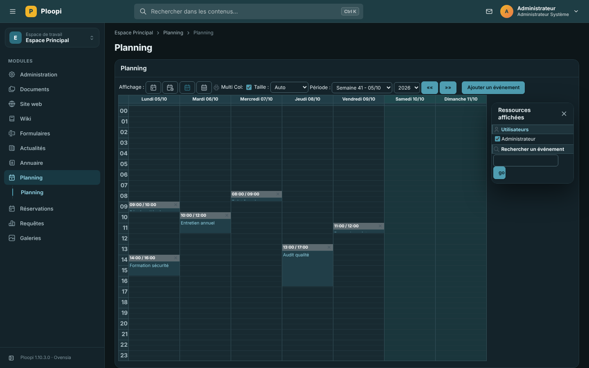 | 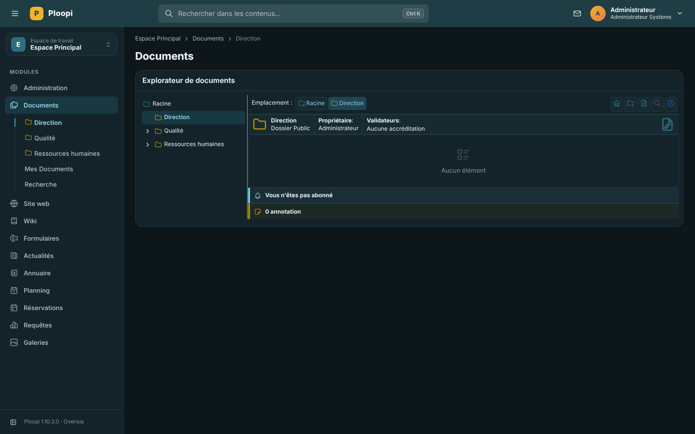 | 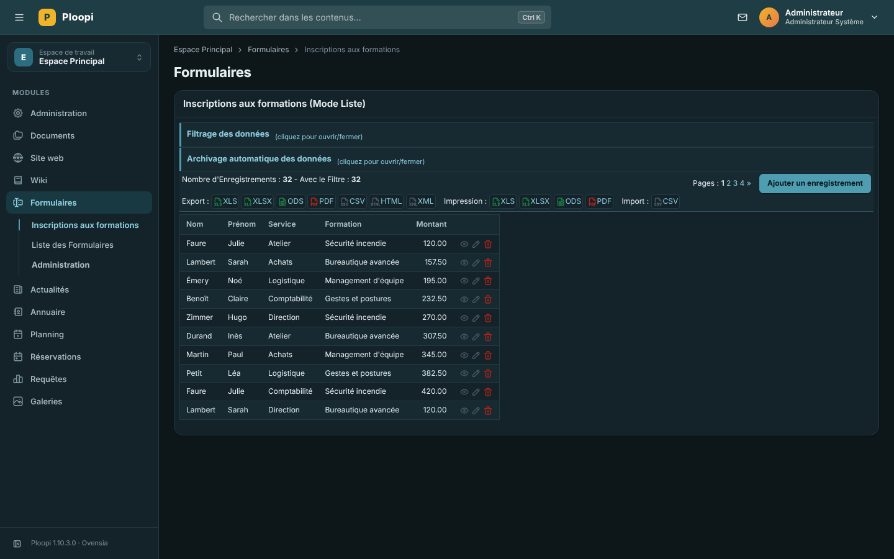 |

**Aucun script ni gestionnaire en ligne** dans le gabarit (hors du JavaScript que le
socle y injecte) : `shell.js` lit des attributs `data-p4-*`. Le thème est rendu côté
serveur sur `<html data-theme>` : pas de script d'amorçage dans `<head>`.

**Icônes.** Un seul jeu, celui de `ploopi3` : Tabler. Le sprite `img/icons.svg` est
généré par `php tools/ploopi4_icones.php` depuis la liste `tools/icones/ploopi4.txt` et
les glyphes de `tools/icones/tabler/outline/` (`--check` pour vérifier). Côté PHP :
`ploopi\skin::get()->icon('users')` ; côté JS : `ploopi.shell.icon('users')`.

**Feuille des modules.** `tools/ploopi3_modules.php` écrit désormais la même palette
des modules dans `ploopi3/css/base_modules.css` et `ploopi4/css/base_5_modules.css`.

**Écrans des modules.** Leur code n'est pas modifié : `ploopi4` agit par les méthodes
du skin et par `css/base_9_modules.css`, propres au gabarit (`ploopi3` n'est pas touché).

- **Fenêtres** (`create_popup`, `open_popup`, surchargées dans `class_skin.php`) : même
  structure et mêmes classes que le socle (`simplebloc`, poignée `handle_<id>`,
  `ploopi_popup_close` + `data-popup`), titre sur une ligne, bouton de fermeture en
  icône du sprite avec nom accessible (l'image du socle, blanche, ne se voyait plus sur
  l'en-tête clair) ;
- **listes déroulantes à largeur fixée** par le module (heures, minutes du planning) :
  marges internes réduites, la valeur n'est plus rognée par la flèche ;
- **petits écrans** (≤ 760 px) : colonnes posées en flottants à largeur en pourcentage,
  en style en ligne (fiche d'un contact de l'annuaire, actualités sur deux colonnes) ou
  dans la feuille du module (arborescence de la GED, de l'annuaire partagé, de webedit ;
  encadrés de la GED et du wiki ; panneaux de dbreport et de nanogallery), empilées sur
  une colonne ; formulaires du socle (`.ploopi_form`) et de webedit avec le libellé
  au-dessus du champ ; champs à largeur fixe bornés à l'écran ; fenêtre « Ressources
  affichées » du planning replacée sous la page au lieu de couvrir le calendrier ;
- **actualités** : colonne d'image vide masquée (actualité sans image) ;
- **titre de page** (`create_pagetitle`, surchargée) : un `<h1>`, même aspect ;
- **arborescences** (`display_treeview`, surchargée) : mêmes nœuds, mêmes identifiants
  (`treeview_node<id>`, `t<id>`, `n<id>`), donc mêmes dépliages AJAX ; chevron du sprite
  au lieu des images plus/moins, filets des niveaux en CSS, nœud sélectionné surligné,
  lignes plus hautes (doigt). L'arbre propre à nanogallery garde ses images.

| GED : dossier profond ouvert | Sur téléphone |
|---|---|
| 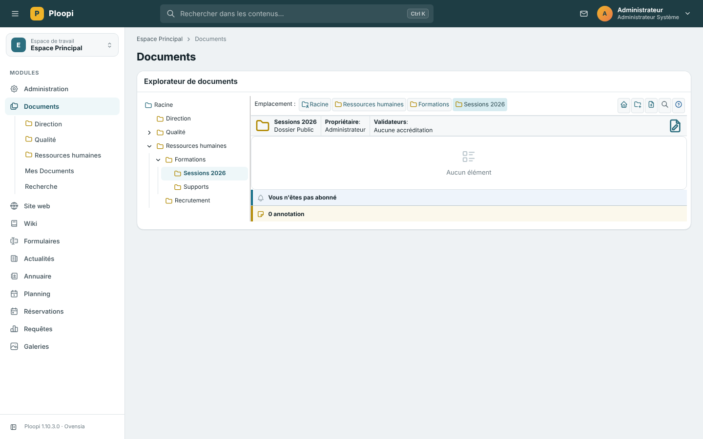 | 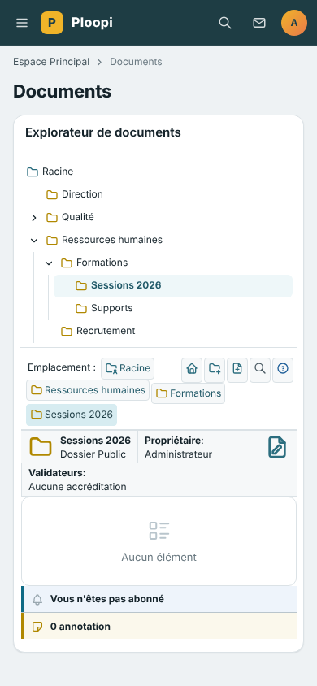 |

**Annuaire sur téléphone** (module `directory` 2.5.10) : l'arbre des rubriques partagées
est replié au chargement derrière un résumé « Racine : … » (un `<details>` du module dont
le résumé n'est affiché que par `ploopi4` sous 760 px : ailleurs, rendu inchangé) ; barres
d'actions sur plusieurs lignes, légende par paires insécables.

| Rubrique ouverte, arbre replié | Arbre ouvert |
|---|---|
| 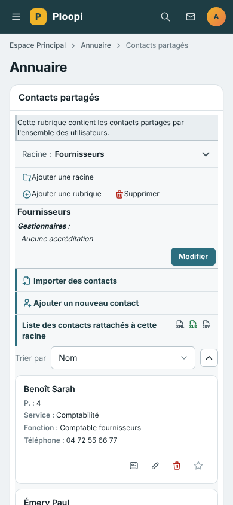 | 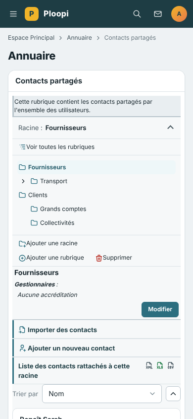 |

**Saisies de forms** (module `forms` 3.9.3) : une carte par saisie sur téléphone, en-têtes
de tri en pastilles (marques `data-label` posées par le module, sans effet ailleurs).

**Calendriers du planning et des réservations** : grille fluide (§ 4.2), ressources
affichées dans une colonne à côté du calendrier, au-dessus sur un écran étroit.

**Barres d'actions** (`.ploopi_tabs`) : sur plusieurs lignes, dans l'ordre du grand écran.

| Saisies de forms | Planning | Réservations |
|---|---|---|
| 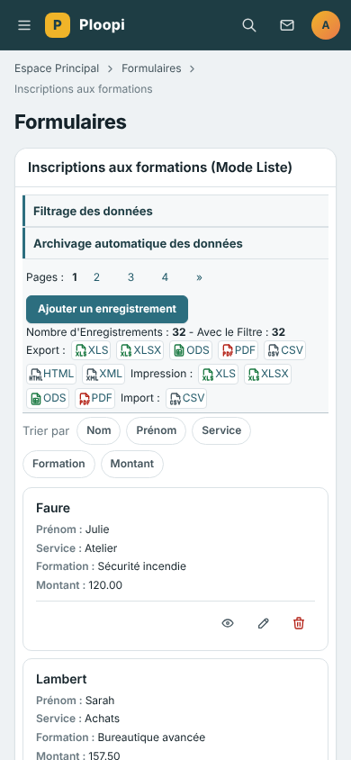 | 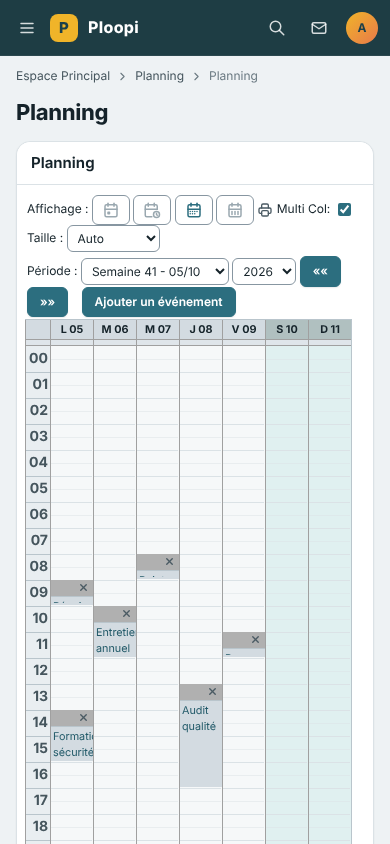 | 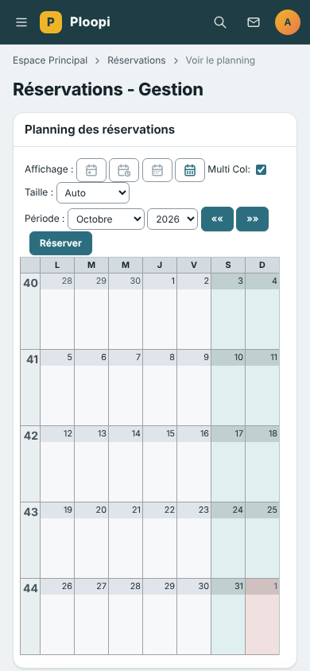 |

Les **tableaux** (`skin::display_array`) sont traités à part (§ 4.1, feuille
`base_9_tableaux.css`) : `base_9_modules.css` n'y touche pas. Le contenu des modules suit
le thème sombre (voir *Thème sombre*).

## 4. Ce que le socle apporte (sans effet sur `ploopi2` et `ploopi3`)

| Fichier | Apport |
|---|---|
| `include/backoffice.php` | variables `USER_INITIALS`, `USER_LEVEL`, `MODULE_TYPE`, `WORKSPACE_INITIAL`, `USER_THEME`, `USER_DENSITY` ; `INITIAL` des espaces ; `MODULETYPE` et `ICON` des modules ; sous-blocs `switch_icon` et `switch_section` des entrées de menu ; fil d'Ariane (bloc `crumb`) |
| `include/light.php` | `USER_THEME`, `USER_DENSITY`, `MODULE_TYPE` |
| `include/classes/block.php` | `addmenu($label, $url, $selected, $target, $icon = '', $section = '')` |
| `include/classes/controller.php` | `addBlockMenu(…, $strIcon = '', $strSection = '')` |
| `include/classes/skin.php` | `version()` (génération du gabarit, clé `version` de `skin.ini`), `icon()`, `moduleicon()`, `getdisplayprefs()` ; `display_array()` fluide (§ 4.1) |
| `js/skin.js` | largeur automatique des rendus dessinés en pixels (`ploopi.skin.autowidth`, attributs `data-autowidth-*`) ; tri et pagination des tableaux fluides dans le navigateur ; `ploopi.skin.array_refresh()` les traite sans requête ; `ploopi.skin.treeview_shownode()` bascule le chevron d'une arborescence de `ploopi4`, sinon l'image plus/moins comme avant |
| `js/popup.js` | fenêtre centrée dans la zone d'accroche (et non la fenêtre du navigateur), largeur bornée à celle-ci : sans effet quand la zone couvre toute la largeur (`ploopi2`, `ploopi3`). `ploopi.popup.ize()` (fenêtres de `open_popup`) : plus d'appel à Prototype (retiré, la fenêtre centrée levait une erreur), position donnée par rapport au navigateur ramenée à la zone d'accroche et fenêtre gardée entière dans celle-ci (la fenêtre « Ressources affichées » du planning sortait de l'écran ; correctif valable pour tous les gabarits) |
| paramètres `system_theme`, `system_density` | module `system`, publics : défaut, espace, utilisateur (*Mon espace → Mes paramètres*) ; enregistrés aussi depuis le menu utilisateur (opération `system_display_prefs_save`, valeurs prévues seulement) |

Un module peut donc doter son menu d'icônes et de sections : `ploopi4` les affiche, les
autres gabarits les ignorent.

### 4.1 Tableaux avancés : `display_array()` fluide

Sous un gabarit de génération 4, `skin::display_array()` rend un `<table>` unique
(`table.p4-table.p4-arr` dans `div.p4-arr-main#ploopi_explorer_main_<id>`) au lieu des
colonnes flottantes à largeur fixe. Les modules n'ont rien à changer : mêmes colonnes,
mêmes valeurs, mêmes options.

- **Colonnes** dans l'ordre visuel de l'affichage historique : `actions_left`, `left`,
  `auto`, puis `right` et `actions_right` inversés (les flottants à droite plaçaient la
  première colonne déclarée le plus à droite). `width` devient la largeur de l'en-tête ;
  les colonnes d'actions sont au plus juste, sans retour à la ligne des icônes.
- **Tri et pagination dans le navigateur** (`js/skin.js`) : ni `ploopi_skin_array_refresh`
  ni variable sérialisée. Le serveur fait le tri initial et masque les lignes hors page ;
  chaque cellule triable porte sa clé (`data-p4-arr-key` : texte affiché, en majuscules
  sans accents ; `sort_label` s'il est fourni), comparée en ordre naturel (`Intl.Collator`),
  ou en nombre pour `sort_flag => SORT_NUMERIC`, puis par rang d'origine. Un tableau
  nommé retrouve son tri et sa page pour la session de l'onglet (`sessionStorage`) ;
  `callback` est rappelé après chaque tri ou changement de page, avec `(id, orderby,
  page)` comme avant. Les tableaux insérés après le chargement (GED, fenêtres, AJAX) sont
  pris en charge à leur insertion (`MutationObserver`).
- **Lien de ligne** (`link`, `onclick`, `option`) : une ancre dans la cellule titre
  (première colonne `auto`, sinon `left`), étendue à toute la ligne ; `description`
  devient son `title`, sans balises et échappée (elle ne l'était pas).
- **Affichage en cartes** quand le tableau dispose de moins de 640 px (requête de
  conteneur, donc aussi dans une colonne étroite sur grand écran) : en-têtes masqués,
  barre « Trier par » à leur place, cellule titre en tête, autres cellules en
  « libellé : valeur », actions en bas. Un tableau placé dans un contexte à largeur
  intrinsèque (cellule de tableau, flottant sans largeur) retrouve l'affichage en
  tableau plutôt que de s'effondrer (classe `p4-arr-nocq`).
- **Tableau vide** : état vide « Aucun élément » au lieu des seuls en-têtes.
- Feuille dédiée : `css/base_9_tableaux.css`.

`ploopi2` et `ploopi3` gardent exactement le rendu et le rafraîchissement AJAX
historiques (vérifié octet pour octet). Au passage, une colonne `actions_left` triable
n'écrit plus son tri dans `actions_right`, et une ligne dépourvue de la colonne de tri
ne lève plus d'avertissement.

| Grand écran | Téléphone |
|---|---|
| 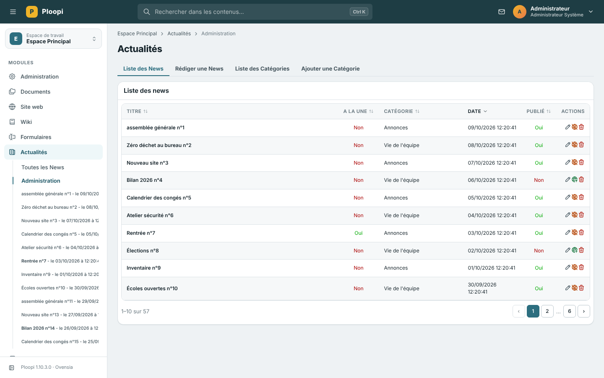 | 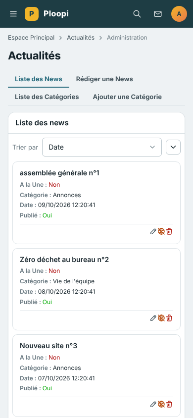 |
| 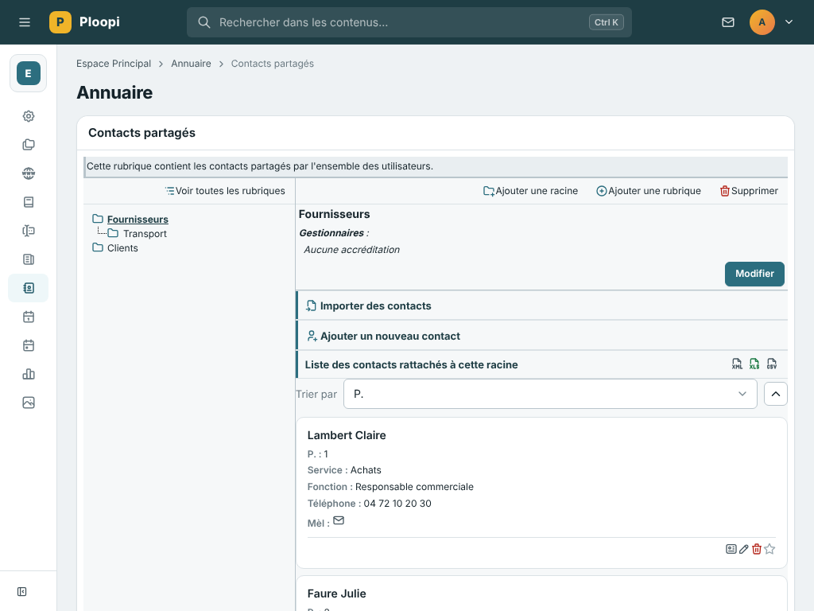 |  |

### 4.2 Planning en grille fluide : `ploopi\calendar`

Sous un gabarit de génération 4, en backoffice, `ploopi\calendar::display()` rend une
grille CSS (`base_5_calendar_p4.css`) au lieu du dessin en pixels ; le frontoffice et
`ploopi2`/`ploopi3` gardent le rendu historique. Mêmes options, mêmes événements, mêmes
canaux : aucun changement dans les modules pour en profiter.

- **Largeur** : celle de la page, jamais calculée côté serveur (la taille « Auto » ne
  recharge plus rien) ; samedi et dimanche plus étroits ; défilement horizontal entre les
  jours sur téléphone. La hauteur demandée (option « Taille ») fixe celle d'une heure.
- **Journées** : heures et événements placés en pourcentage de la journée ; la grille
  défile dans son cadre, en-têtes fixes, et s'ouvre sur le premier événement de la période
  (8 h au plus tard) ; journée et heure courantes repérées ; événements simultanés en
  cascade ; dans un événement étroit, l'essentiel (requêtes de conteneur).
- **Mois** : semaines en lignes, événements en pastilles (traits de couleur sur
  téléphone), jours du mois voisin grisés.
- **Couleurs** : celle de l'événement (ressource, état) en liseré et en teinte du fond,
  lisible dans les deux thèmes.
- **Déplacement** (`arrOnDrop`) : `js/calendar_grid.js`, à la souris ou au doigt, par
  l'en-tête de l'événement, à la demi-heure ; même requête que le rendu historique.
- **Comportements** : options `arrAttrs` et `arrCloseAttrs` (CSP stricte) ; `strOnClick` et
  `strOnClose` restent rendus pour les modules non migrés.

| Semaine | Mois |
|---|---|
| 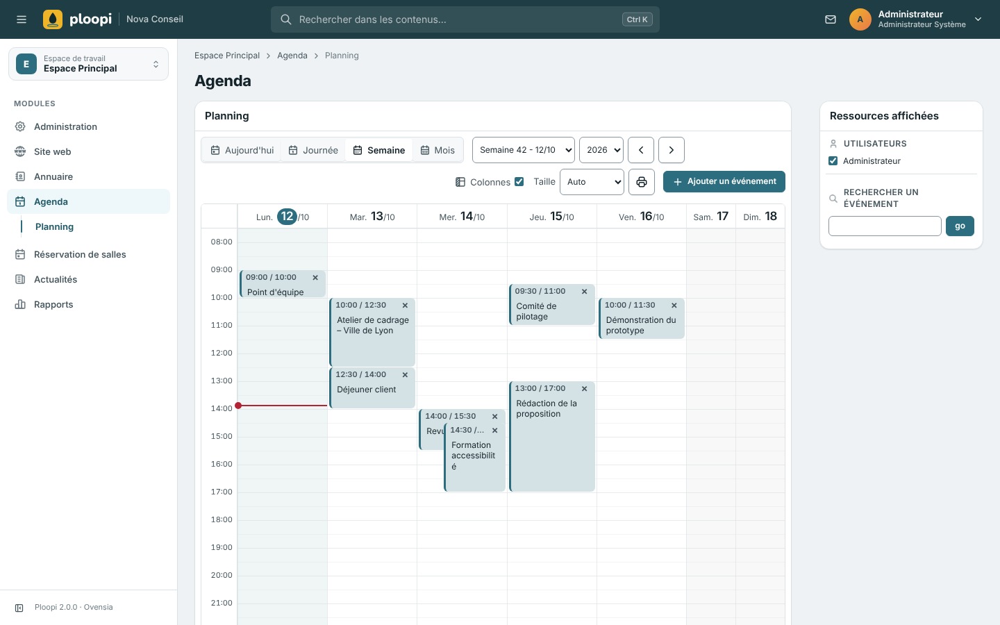 | 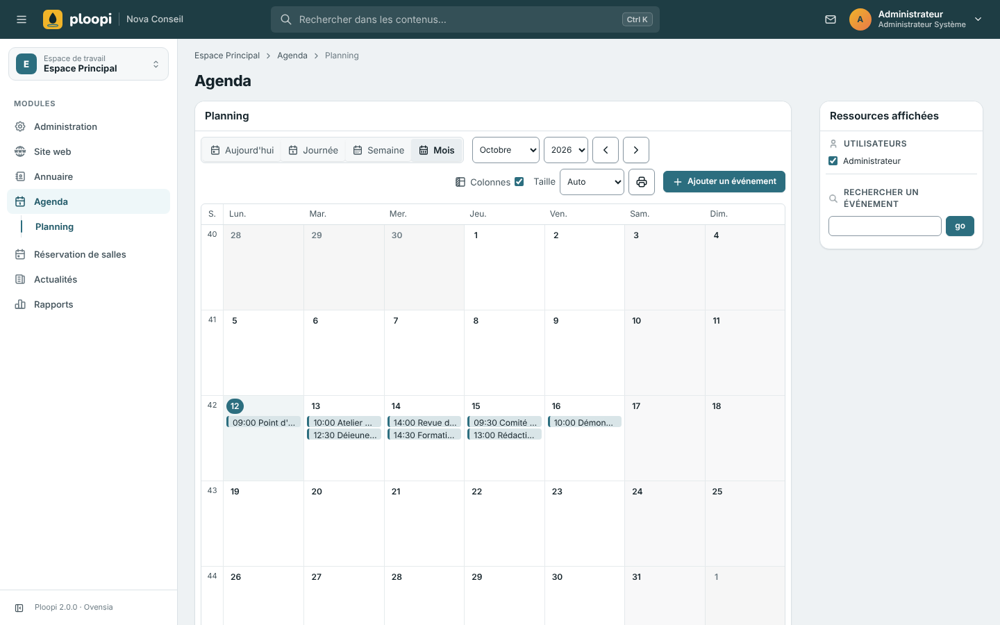 |
| 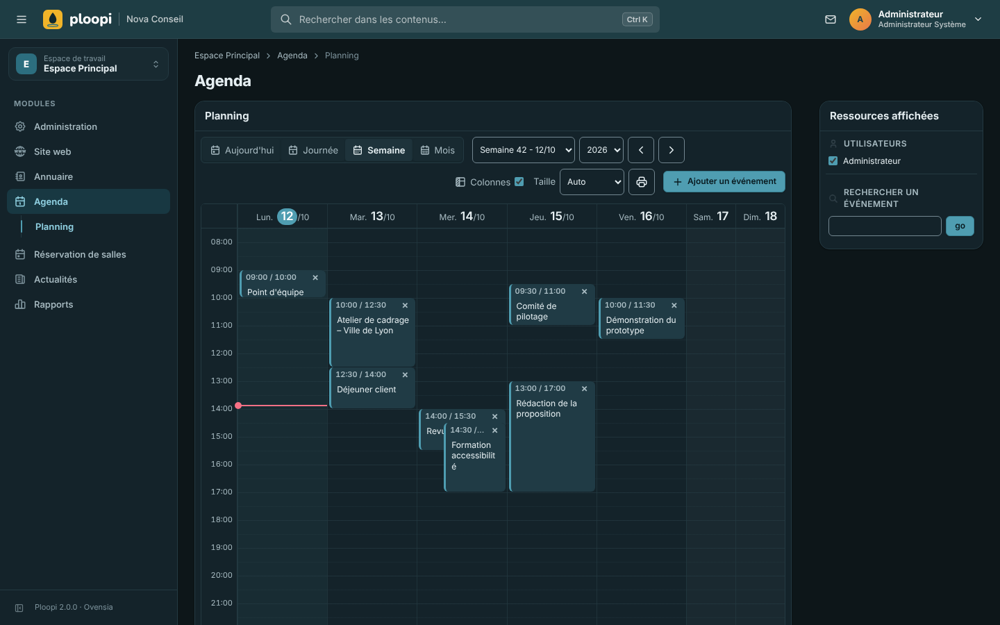 | 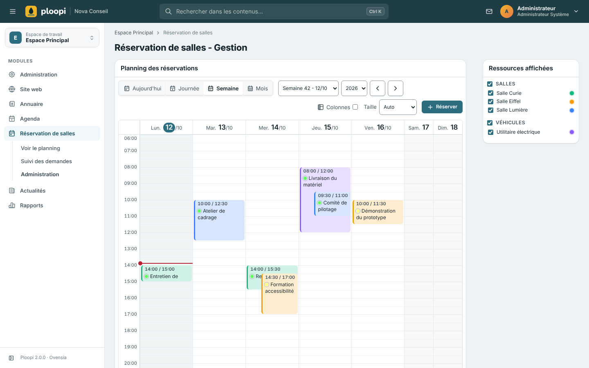 |

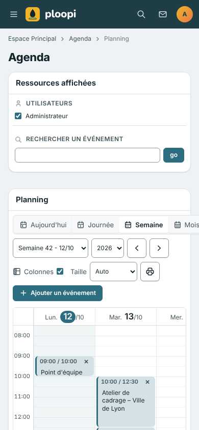

Trouvé en chemin : la règle qui dimensionne le choix d'une date (`#calendar`, 240 px,
centré) s'appliquait aussi au planning, qui porte le même identifiant : le calendrier se
dessinait étroit, décalé à droite, laissant vide la moitié de la zone. Elle ne vise plus
que le choix d'une date (`[data-ploopi-calendar-field]`).

### 4.3 Choix des droits, calendriers des modules, aperçu SQL

Retouches sans effet sous `ploopi2`/`ploopi3` (rendu conditionné à `version() >= 4`,
identifiants, noms de champs et attributs `data-*` inchangés).

- **Choix des groupes et utilisateurs** (`share::selectusers()`,
  `validation::selectusers()`, rendus par `ploopi\userselect`) : carte, champ de recherche
  avec son bouton, résultats en liste, sélection en pastilles qu'un clic retire. Partout
  où un module choisit des validateurs ou des partages (webedit, doc, wiki…) ; les
  fieldsets de webedit autour (`webedit_rights`) sont des cartes.
- **Barre d'outils du planning** (planning, booking) : vues en contrôle segmenté,
  période et chevrons, options à droite, bouton principal ; repli sur téléphone.
- **Colonne « Ressources affichées »** : une ligne par ressource, sa couleur en pastille
  (`--p4-res`), ressource décochée estompée.
- **Fenêtres de saisie** (`.p4-evform`) : grille à deux colonnes, libellés au-dessus,
  date et heure groupées, boutons en pied ; en consultation de booking, chaque événement
  en carte, couleur d'état en bande latérale. État d'une réservation dans le calendrier :
  pastille devant l'objet (`.p4-cal-status`).
- **Aperçu SQL de dbreport** : coloration par classes, lisible dans les deux thèmes,
  bouton « Copier la requête ».

| Saisie d'un événement | Saisie d'une réservation |
|---|---|
| 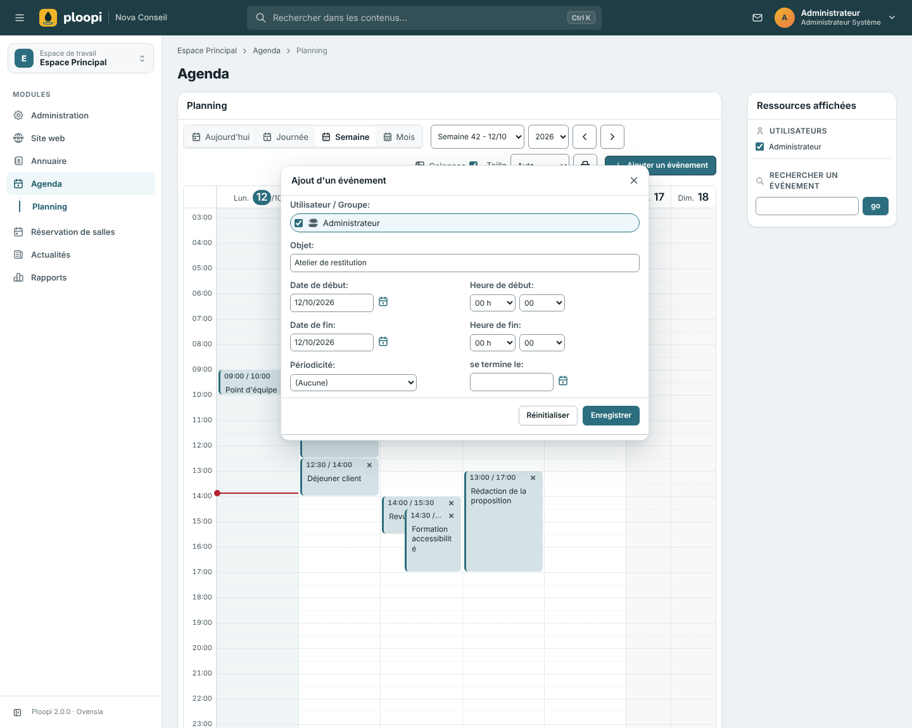 | 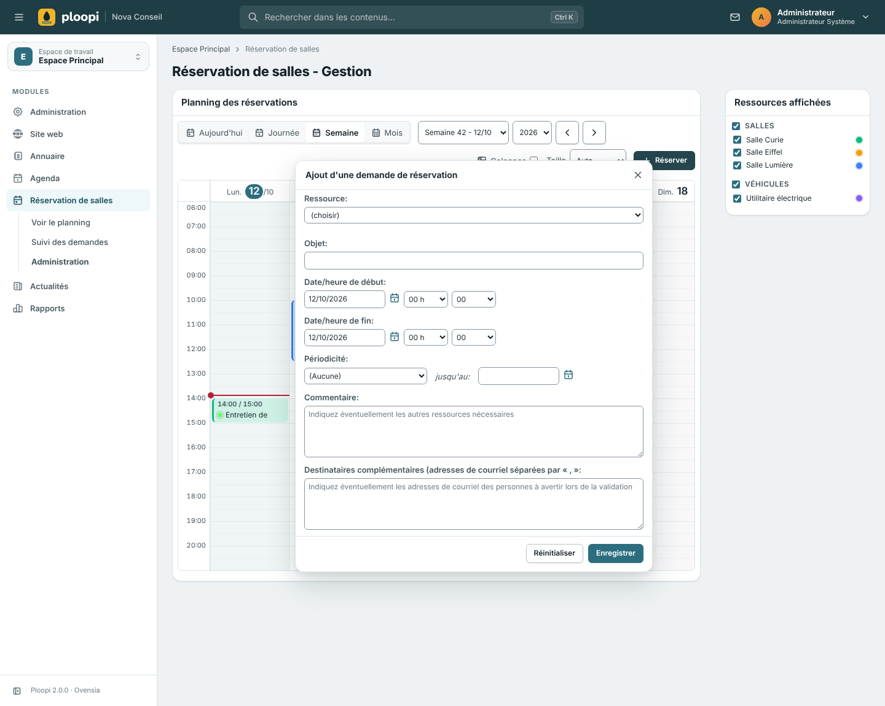 |
| 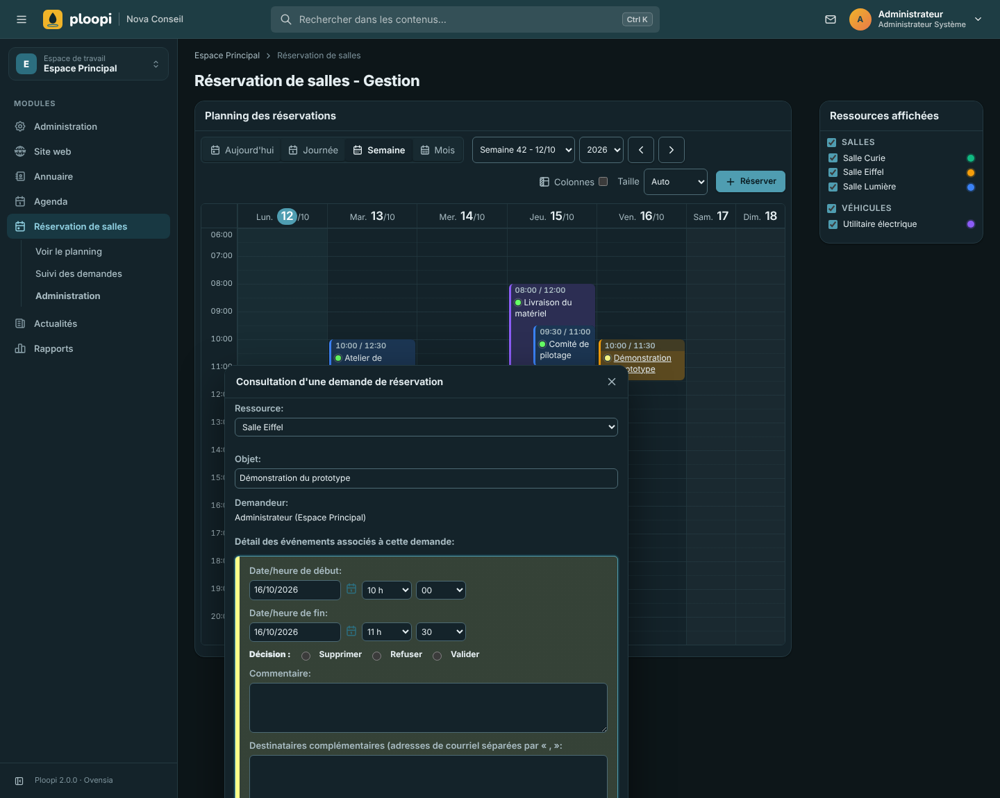 | 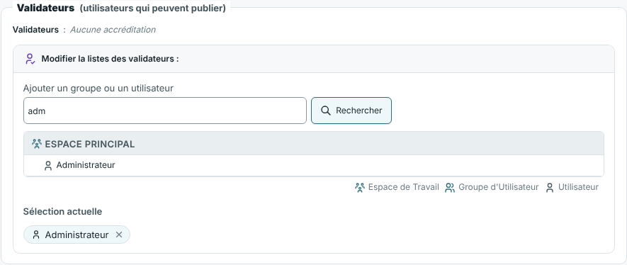 |

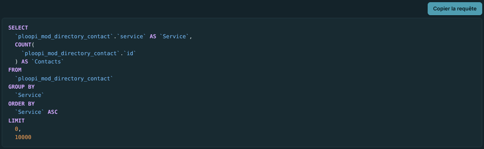

## 5. Le module `system`

Les écrans refondus ne s'affichent qu'avec un gabarit de génération 4
(`ploopi\skin::get()->version() >= 4`) ; sous `ploopi2` et `ploopi3`, les écrans
historiques restent servis. La bascule se fait en tête de l'écran historique, qui garde
les traitements (enregistrements, opérations) :

```php
if (ploopi\skin::get()->version() >= 4)
{
    include './modules/system/admin_workspaces_modules.php';
    return;
}
```

- **Menu latéral** (`block.php`) : sections *Organisation* (Espaces de travail) et
  *Système* (Modules, Paramètres, Utilisateurs, Outils, Mise à jour si la base est en
  retard), une entrée par écran ; la barre d'outils du niveau « système » disparaît.
  *Mon espace* reçoit ses icônes.
- **Espaces de travail** (`admin_workspaces*.php`, `include/workspaces.js`) :
  arborescence filtrable et repliable avec le nombre d'utilisateurs rattachés (tiroir
  sous 1100 px), en-tête de l'espace ou du groupe avec son chemin, onglets. L'onglet
  *Utilisateurs* est une liste avec recherche, filtres, initiale, tri, pagination,
  sélection, actions groupées (détacher, exporter la sélection), exports, et un menu
  *Ajouter* (créer, rattacher, importer, rattacher un groupe) ; la fiche s'ouvre en
  tiroir (`system_user_card`).
- **Onglets d'un espace ou d'un groupe** : *Espace* / *Groupe* (formulaire par sections,
  chiffres clés), *Modules* (ordre, interrupteurs actif / visible / partagé / hérité,
  propriétés, ajout d'une instance), *Paramètres* (modules à gauche, valeurs à droite),
  *Rôles* (liste filtrable, fiche avec les actions du module, attributions par
  recherche), groupes rattachés, rattacher un utilisateur ou un groupe, import
  (envoi, aperçu, compte rendu), fiche d'un utilisateur (formulaire par sections,
  photo, jauge du mot de passe).
- **Système** : *Modules* (installés, mises à jour proposées, paquets disponibles,
  comptes rendus d'installation et de mise à jour), *Paramètres*, *Utilisateurs*
  (annuaire : filtres, tableau filtrable, exports), *Outils* (un pavé par outil, puis
  l'outil avec un lien de retour ; journal des actions, diagnostic, charge, statistiques,
  utilisateurs connectés, sauvegarde SQL, configuration de PHP), *Mise à jour*.
- **Mon espace** : *Mes messages* (boîtes, tri, messages dépliables, fil des réponses,
  validation, suppression groupée), *Mes annotations* (étiquettes, notes paginées),
  *Mon profil* (même formulaire que la fiche, champs du profil seulement), *Mes
  informations* (droits par espace et par module), *Mes paramètres*, *Recherche*
  (formulaire et résultats, pertinence en jauge).
- **Mêmes droits que les écrans historiques**, revérifiés côté serveur ; les contrôles
  manquants trouvés en chemin sont corrigés pour tous les gabarits (§ 5.2).

### 5.1 Composants : `ploopi\system\ui`, `include/p4.js`

`modules/system/classes/ui.php` rassemble le balisage des écrans refondus, en méthodes
statiques qui renvoient du HTML échappé : `pagehead()`, `card_open()` / `card_close()`,
`section_open()` / `section_close()`, `field()`, `input()`, `textarea()`, `select()`,
`toggle()`, `date()`, `formactions()` (barre d'actions collée en bas de la zone
visible), `button()`, `actions()`, `menu()`, `badge()`, `callout()`, `emptystate()`,
`stats()`, `seg()`, `table()` (tableau filtrable, triable, paginé), `report()` (compte
rendu d'installation), `icon()`, `e()` (échappement).

`include/p4.js` porte les comportements, par attributs `data-p4-*` et délégation
d'évènements sur le document, sans gestionnaire en ligne : confirmation, validation des
formulaires (`ploopi.validatefield`), envoi au changement, navigation par liste,
cases « tout cocher », tableaux, chargements dans un élément (`admin-light.php`),
recherche, photo, jauge du mot de passe, couleur, messagerie. Les contenus chargés
ensuite en profitent sans réinitialisation.

Cette règle permet de servir les écrans de `system` (et la page de connexion) en
**Content-Security-Policy stricte** (`ploopi\csp`, `doc/deploiement.md` § 8) : seuls les
scripts du site et les scripts en ligne du socle portant le nonce de la session
s'exécutent. Un écran qui insère un composant historique doit donc le prendre sans
gestionnaire en ligne : la GED du socle (`data-ploopi-documents`, `js/documents.js`) et
les fenêtres de `create_popup` (rendues déplaçables par `js/popup.js` à leur insertion)
le sont. Sinon, le contrôle de fin de requête garde la politique de base à la page et
journalise l'écart (« CSP stricte non appliquée ») ; mais un fragment AJAX chargé dans
une page stricte voit ses gestionnaires en ligne **bloqués**.

**Composition d'un message.** Les fenêtres de nouveau message, de réponse et de
modification (`include/op/tickets.php`, socle : elles s'ouvrent aussi depuis l'annuaire et
la GED) ont leur balisage de `ploopi4` : champs `p4-*`, destinataires en pastilles
retirables, recherche à la frappe (utilisateurs, groupes ou espaces, résultats groupés par
espace), message d'erreur dans la fenêtre plutôt qu'une alerte, fenêtre centrée. Le
comportement est dans `js/tickets.js` (attributs `data-p4-ticket-*`, délégation), sans
script ni gestionnaire en ligne dans la fenêtre. Les autres gabarits gardent les fenêtres
historiques. Le message se saisit dans l'éditeur du socle (TinyMCE, `js/editor.js`, cf.
`doc/developpement.md`).

**Annotations.** Le bloc d'annotations du socle (`ploopi\annotation::display()`, inséré par
les modules et les écrans des espaces et des groupes) est refondu : bandeau repliable avec le
nombre d'annotations, fil des annotations (initiales, auteur, date, pastille « Privée »,
étiquettes cliquables, suppression de la sienne), formulaire d'ajout (texte requis,
étiquettes facultatives avec suggestions, case « Privée »), message d'erreur dans le bloc. La
fenêtre des annotations d'une étiquette suit le même dessin. Comportement dans
`js/annotation.js` (attributs `data-p4-anno-*`, délégation), sans script ni gestionnaire en
ligne ; les autres gabarits gardent le bloc historique.

Les outils historiques (`tools_*.php`) et la recherche rendent leurs blocs et leurs
tableaux par `system_open_bloc()`, `system_close_bloc()` et `system_display_array()`
(`include/functions.php`) : `skin::open_simplebloc()` et `display_array()` sous
`ploopi2`/`ploopi3`, cartes et `ui::table()` sous `ploopi4`.

### 5.2 Correctifs de sécurité

Valables pour tous les gabarits ; suites 38 et 39.

- Consulter, modifier ou supprimer un utilisateur (`modify_user`, `save_user`,
  `delete_user`) exige qu'il relève de l'administrateur connecté
  (`system_user_isadministrable()`).
- Onglets *Modules*, *Paramètres*, *Rôles* : opérations réservées aux administrateurs
  d'espace ; opérations sur une instance rattachée à l'espace (et qui lui appartient pour
  la modifier) ; paramètres d'un module rattaché, `idmodule` numérique ; rôles de
  l'espace seulement, attribués à des utilisateurs ou groupes de l'espace.
- Fiche et profil : ni identifiant, ni empreinte du mot de passe, ni dates système depuis
  le formulaire ; le profil n'accepte que ses champs (l'identifiant, l'état du compte et
  la date d'expiration étaient modifiables par l'utilisateur lui-même).
- Rattachements d'utilisateurs et de groupes dans la portée de l'administrateur ; niveau
  d'un utilisateur ou d'un groupe rattaché au plus égal au sien (un administrateur
  d'espace pouvait nommer un administrateur système).
- Annuaire : suppression des utilisateurs d'un filtre réservée aux administrateurs
  système.
- Messagerie : ouverture, réponses, citation et validation réservées à l'émetteur et aux
  destinataires du message ; modification à son émetteur, titre et contenu seulement
  (« Citer » affichait tout message, et la modification réécrivait le message de
  n'importe qui). Nouveau message et réponse s'enregistrent en mode SQL strict (ils
  échouaient : `''` dans des colonnes entières).
- Recherche : module choisi entier et parmi ceux de l'espace (il entrait tel quel dans
  la requête) ; paramètres personnels limités aux modules des espaces de l'utilisateur.

## 6. Vérifications faites

Sur une instance de test (`tests/instance.sh up`), données fictives : une centaine
d'utilisateurs, une quinzaine de groupes sur trois niveaux, quatre espaces ; six
modules installés et instanciés depuis les écrans de `ploopi4` ; messages, annotations
et contenus indexés.

- **Parcours Playwright** à 1440, 1024 et 390 px, clair et sombre : chaque écran de
  `system` (onglets d'un espace et d'un groupe, niveau Système et chaque outil, Mon
  espace), six modules, fenêtres de messagerie, tiroirs et menu sur téléphone :
  **aucune erreur JavaScript, aucune réponse en erreur**, toutes les icônes rendues
  présentes dans le sprite ;
- **actions** : préférences, détachement groupé, export d'une sélection, création et
  modification d'un utilisateur, rôles (création, attribution, retrait), modules
  (ordre, interrupteurs, propriétés, installation, mise à jour), paramètres d'un espace
  et d'un utilisateur, profil (avec des champs interdits ajoutés au formulaire :
  ignorés), messages (lecture, réponse, validation), recherche, sauvegarde SQL
  (archive rechargée dans une base vierge : tables et sommes de contrôle identiques) ;
- **tableaux fluides** (§ 4.1) : dix modules installés par le backoffice, chaque entrée
  de leur menu parcourue à 1440 px (clair) et 390 px (sombre), sans erreur JavaScript
  ni défilement horizontal ; tri (accents, nombres), inversion, pagination, retour sur
  une liste triée, `array_refresh()` et rappel du module, tableau inséré après le
  chargement, barre de tri des cartes ;
- **journal d'erreurs PHP** : rien ne provient des fichiers ajoutés ou modifiés ;
- **suites** 37, 38, 39 et la suite complète (§ 7).

## 7. Tests

| Suite | Contenu |
|---|---|
| `37_ploopi4_gabarit` | contrat (identifiants, blocs, images), rien en ligne, sprite à jour et complet (toute icône demandée par le gabarit, le shell et les écrans de `system`, composants de `ploopi\system\ui` compris), libellés des écrans refondus définis, agrégat CSS, exclusion de `.p4-ui`, palette `--p3-*`, `block::addmenu`, `skin::version/icon/moduleicon/getdisplayprefs`, paramètres en base, libellés ; écrans des modules : fenêtres de `class_skin.php` (bouton de fermeture, poignée, `open_popup` sans fermeture), titre de page en `<h1>`, arborescence (identifiants, chevron, sélection, dépliage du module), `js/popup.js` sans Prototype, agrégat de `base_9_modules.css` ; `display_array` fluide (ordre des colonnes, clés de tri, tri et page initiaux, lien de ligne échappé, état vide, pas de variable sérialisée ; rendu historique sous `ploopi3`) |
| `38_ploopi4_system` | shell et écran refondu servis, liste complète, préférences (valeur hors liste, jeton), fiche réservée aux utilisateurs administrables, formulaire refusé hors périmètre, détachement groupé (niveau supérieur épargné), export restreint à une sélection, écran historique sous `ploopi3` |
| `39_ploopi4_ecrans` | chaque écran refondu servi complet (onglets d'un espace et d'un groupe, niveau Système et outils, Mon espace, fil des réponses) ; correctifs du § 5.2 (modules, paramètres et rôles d'un autre espace, attribution hors espace, champs protégés de la fiche et du profil, rattachement hors portée, niveau d'un utilisateur et d'un groupe, paramètres personnels, suppression en masse par un gestionnaire, messages d'autrui) ; sauvegarde SQL ; mise à jour d'un module déjà à jour ; écrans historiques sous `ploopi3` |

## 8. Limites et suites

Limites connues : mises en
page propres aux modules (largeurs en pixels, tableaux de mise en page, formulaires
historiques) gardées en `ploopi3`, CSP encore en *Report-Only*, pas de « rester
connecté », navigateurs récents requis (`:has()`, requêtes de conteneur). Limites levées
depuis : § 3.31.
